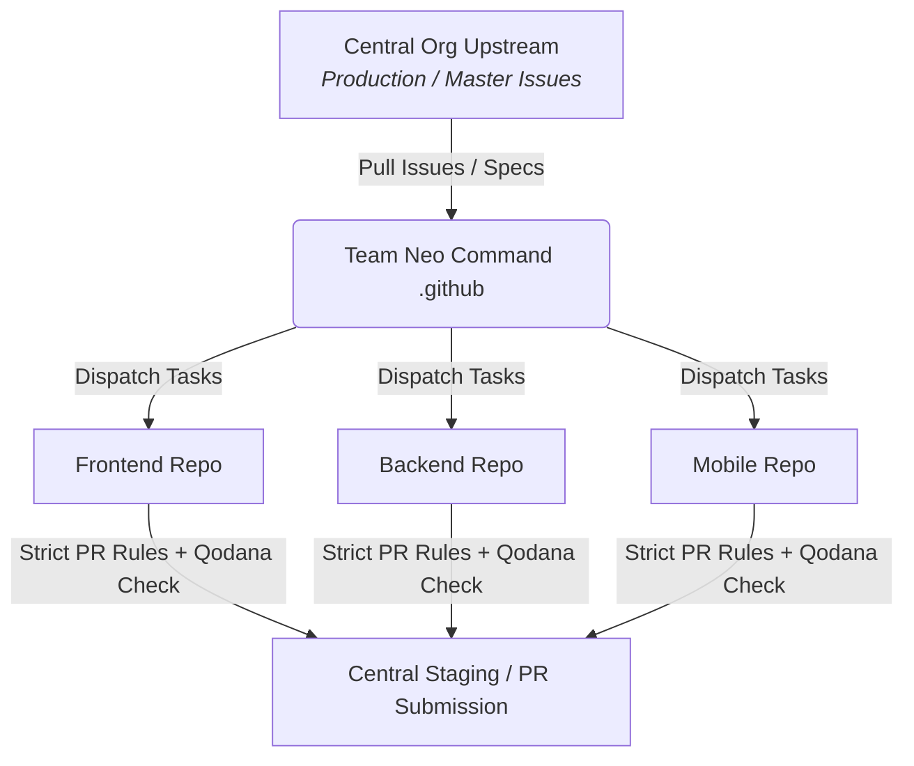

# ⚡ SYSTEM STATUS: ONLINE // TEAM NEO

> *"The matrix is a system... but we have root access."*

---

## 📡 Live Construct Telemetry

---

## 🗺️ 1. The Multiverse Architecture
Team Neo coordinates operations across multiple environments. Here is where the code lives, where the databases sync, and how we map our pipelines:

| Sector | Stack / Component | Target Database | Repository Link | Operational Role |
| :--- | :--- | :--- | :--- | :--- |
| **01 // Core Web** | Next.js / TypeScript | Database A *(Primary Web)* | [Access Repo](url) | Main user-facing web portal |
| **02 // Mobile App** | Cross-Platform | Database B *(Mobile State)* | [Access Repo](url) | Client mobile application layer |
| **03 // Backend Engine**| API / Microservices | Database C *(Core Logic)* | [Access Repo](url) | Server-side routing & business logic |

---

## ⚡ 2. Upstream & Downstream Pipeline Flow
Operational flow from external production requirements down to internal execution:

---

## 🎯 3. Active Mission Directives (Week 2 Operations)
* **Status:** 🟢 Live Execution Across All Sectors
* **Comms Channel:** [Telegram Secure Line](https://t.me/zedu_new_one)
* **Master Deadlines:** *[Insert Milestone Targets]*

| Task ID | Component | Upstream Issue Ref | Downstream Status | Execution Link |
| :--- | :--- | :--- | :--- | :--- |
| **TN-X01** | Frontend / Web | [Issue #--](url) | 🟡 In Progress | [Terminal](url) |
| **TN-X02** | Backend / API | [Issue #--](url) | 🔴 Pending Sync | [Terminal](url) |
| **TN-X03** | Mobile App | [Issue #--](url) | 🟡 Compiling | [Terminal](url) |

---

## 🛡️ Protocol Directives (CONTRIBUTING.md)
1. **The Single PR Rule:** One mission per branch. No overlapping changes, no glitching the matrix.
2. **Quality Gates:** All checks must run clean. We don't ship corrupted code.
3. **Comms:** Real-time synchronization happens via [Telegram](https://t.me/zedu_new_one).
